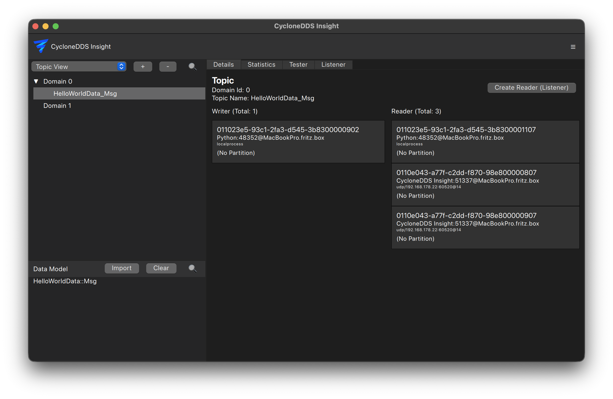

..
   Copyright(c) 2024 Sven Trittler

   This program and the accompanying materials are made available under the
   terms of the Eclipse Public License v. 2.0 which is available at
   http://www.eclipse.org/legal/epl-2.0, or the Eclipse Distribution License
   v. 1.0 which is available at
   http://www.eclipse.org/org/documents/edl-v10.php.

   SPDX-License-Identifier: EPL-2.0 OR BSD-3-Clause

Topic View
==========

This view is the default view when starting |var-project|, it shows all discovered DDS Topics in the sidebar on the left side.
By selecting a Topic, the main area under "details" shows information about the selected Topic, including topic name, type, publishers, subscribers, partitions.
When you hover or click on a datareader or datawriter, additional information about the selected entity is shown like QoS settings.

Automatic domain discovery
--------------------------

Open the **+** menu in the sidebar and select **Automatically discover domains**
to open the discovery popup. Choose **Start search** to begin. The search first
checks domain IDs 0–232 briefly, then checks domains without a response for longer.
Progress and results stay in the popup, leaving the topic and participant views
unchanged. The counter counts each searched domain once, after its final result;
the longer observation does not double the total. The full range has 233 domain
IDs. Already joined domains are counted as completed immediately: for example,
two connected domains start at 2 of 233 and are not probed again.

The popup dims the background, like the Add domain window. Choose **Hide**,
press Escape, or click outside to dismiss it while the search continues in the
background.
Reopen it from the same menu to see its progress and results. The stop icon to
the right of the progress bar stops the search.

Only newly found, unjoined domains appear in the results list. Joined
domains disappear from the list and remain counted in the progress. Use a row's
**Join** button for one domain. **Join all** requests all currently found unjoined
domains.

Joining briefly pauses an active search and releases its temporary participants.
The search then continues automatically, keeping its progress and results.
Domains are joined one at a time, with native initialization and available
resources checked before advancing. If resources run out, remaining domains are
left unjoined and the reason is reported in the error center. Discovery never
joins every result automatically.

A domain without a response may still be active, for example when its network
peers are unreachable or discovery is delayed. There is no overall time limit:
the search checks the full range unless you choose **Stop**. If a probe fails, the popup shows an incomplete search and
the error center lists the affected domain IDs and available DDS diagnostics.
You can retry the search or add a known domain ID explicitly.
